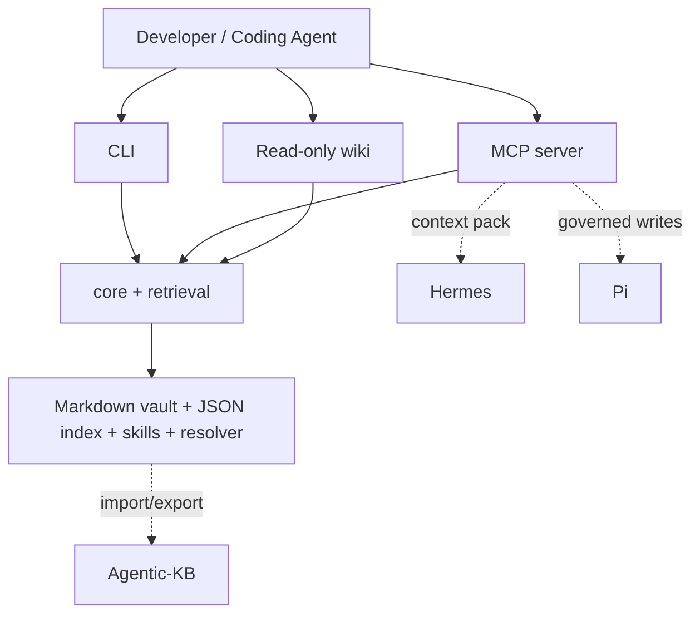

# Mnemonic KB

> **Personal developer memory for agentic engineering.**
> *Thin harness, fat skills, explicit resolver, durable memory.*

[](docs/release-v0.1.0.md)
[](#development)
[](#license)
[](#installation)
[](#installation)
[](#telemetry)

Coding agents start every chat from zero. Mnemonic remembers. It's a **local-first**, **contract-first** Markdown vault + CLI + MCP server + read-only wiki + skill/resolver layer that gives you (and your coding agents) durable repo-aware context across tasks.

Mnemonic does one thing: **memory**. Hermes reasons and acts. Pi governs execution. Agentic-KB enriches. Each system has a single job and clean contracts between them.



---

## Table of contents

- [What it does](#what-it-does)
- [What it is NOT](#what-it-is-not)
- [Installation](#installation)
- [Quick start](#quick-start)
- [Concepts](#concepts)
  - [Pages](#pages)
  - [Memory lifecycle](#memory-lifecycle)
  - [Skills and resolver](#skills-and-resolver)
  - [Context packs](#context-packs)
- [CLI reference](#cli-reference)
- [MCP server](#mcp-server)
- [Wiki](#wiki)
- [Vault layout](#vault-layout)
- [Integrations](#integrations)
- [Development](#development)
- [Status and roadmap](#status-and-roadmap)
- [Telemetry](#telemetry)
- [Contributing](#contributing)
- [Acknowledgements](#acknowledgements)
- [License](#license)

---

## What it does

```bash
# Capture
mnemonic remember "Cancellation must propagate to children" --repo hermes-agent

# Recall
mnemonic search "cancellation"
mnemonic context --task "implement run cancellation" --repo hermes-agent
# → returns a Markdown context pack with cited decisions, lessons, patterns

# Canonicalize
mnemonic inbox promote <id> --reason "design decision worth keeping"
mnemonic promote <proposalId>
# → durable page lands under repos/hermes-agent/decisions/ with append-only timeline
```

Everything lives in plain Markdown in `~/mnemonic-vault`. No database. No cloud. You own the data; you can grep it; you can put it under git.

Designed for use over **MCP** with Claude Code and Cursor, so your coding agent calls `mnemonic.get_task_context` before starting work and `mnemonic.propose_memory` after, building up a compounding context layer across sessions.

## What it is NOT

- **Not** an agent runtime. That's Hermes.
- **Not** a governance engine. That's Pi.
- **Not** an embedding store or vector DB. Plain Markdown + JSON index.
- **Not** a hosted service. Local-first. No cloud. No multi-user.
- **Not** destructive — `delete_memory`, canonical rewrites, and page renames are out of scope for v0.1.
- **Not** instrumented. **Zero telemetry**.

---

## Installation

**Prerequisites:** Node ≥ 20, pnpm ≥ 9.

```bash
git clone https://github.com/jaydubya818/mnemonic-kb.git
cd mnemonic-kb
pnpm install --package-import-method copy --ignore-scripts
pnpm test         # expect 25/25 passing
pnpm -r --workspace-concurrency=1 build
pnpm lint         # expect zero violations
```

Notes:
- `--package-import-method copy` avoids `EPERM` on filesystems without reliable hardlinks (some VM mounts).
- `--ignore-scripts` skips lifecycle scripts; CLI/MCP/wiki binaries are invoked via `node <path>` rather than `node_modules/.bin/`.

## Quick start

```bash
MNCLI="node apps/cli/bin/mnemonic.js"

# 1. Initialize a vault (default: ~/mnemonic-vault)
$MNCLI init --yes --vault ~/mnemonic-vault
export MNEMONIC_VAULT=~/mnemonic-vault

# 2. Capture
$MNCLI remember "Hermes should not own durable memory; it retrieves context from Mnemonic." \
  --repo hermes-agent

# 3. Search and build context
$MNCLI search "Hermes memory"
$MNCLI context --task "implement run cancellation" --repo hermes-agent

# 4. Browse in the read-only wiki
$MNCLI wiki        # http://localhost:4477
# or: pnpm --filter @mnemonic/wiki start
```

Sample output of step 3:

```
# Task: implement run cancellation

## Context Summary
Task: implement run cancellation. Repo/project context: 1 page(s). Found 1 relevant decision.

## Repo / Project Context
- [Hermes Agent](repos/hermes-agent/README.md) — Hermes is the reasoning runtime…

## Relevant Decisions
- [Cancel run policy](repos/hermes-agent/decisions/01J9X8….md) — cancellation
  must propagate to all child runs immediately…

…

---
_Mnemonic context pack v1 · generated 2026-05-10T20:14:55Z · token budget 6000 · confidence medium_
```

---

## Concepts

### Pages

Each page is a Markdown file with YAML frontmatter. **Compiled Truth** at the top (current best understanding); **Timeline** at the bottom (append-only history). Promotion appends to Timeline; it never rewrites Compiled Truth.

```yaml
---
id: 01J9X8000000000000000000   # ULID
schemaVersion: 1
type: decision
status: active                  # draft | active | deprecated | superseded
title: Run cancellation propagates to children
tags: [cancellation, hermes]
aliases: []
repo: hermes-agent
createdAt: 2026-05-10T00:00:00.000Z
updatedAt: 2026-05-10T00:00:00.000Z
source: manual
confidence: high
links: []
evidence: []
---
# Run cancellation propagates to children
## Compiled Truth
Cancel signals must propagate to all child runs immediately and idempotently.
## Timeline
- 2026-05-10 — Initial decision.
```

**Page types:** `repo`, `project`, `decision`, `lesson`, `pattern`, `prompt`, `meeting`, `person`, `agent`, `note`.

### Memory lifecycle

```
remember "<x>"                            mnemonic remember (CLI / MCP)
   │
   ▼
inbox/<id>.md       type: note, status: active, # Captured + # Hints
   │
   │  inbox promote <id>  --reason "..."
   ▼
_proposals/<id>.md  status: open
   │
   │  promote <id>
   ▼
canonical page      typed by filing rules
                    OR appends to existing target's ## Timeline
                    + proposal preserved with status: promoted (audit trail)
```

- `remember` writes to **inbox only**, regardless of any `--type` hint. Promotion is the only path to canonical memory.
- **No destructive operations.** Proposals stay on disk after `promote` or `reject`. Pages move to `status: deprecated` instead of being deleted.
- See [docs/memory-lifecycle.md](docs/memory-lifecycle.md).

### Skills and resolver

Skills are Markdown documents under `<vault>/.mnemonic/skills/`. Each `SKILL.md` carries typed frontmatter (`parameters`, `lanes`, latent/deterministic `steps`) plus a body that's read by humans **and** LLMs. The runtime never executes code from a skill body.

The **resolver** (`RESOLVER.md`) is a Markdown table mapping intent → skill. `mnemonic check-resolvable` audits the layer for structural integrity.

v0.1 ships **8 active skills**:

```
memory/remember              memory/propose-memory       memory/promote-memory
retrieval/get-task-context   retrieval/repo-context
maintenance/check-resolvable maintenance/skillify       (procedural doc only in v0.1)
integrations/hermes-context
```

### Context packs

`mnemonic.get_task_context` returns a Markdown block with cited decisions, lessons, patterns, and repo/project context for a task. Ranks by hand-rolled BM25-lite with status/recency/repo penalties+bonus; deprecated pages get a relevance penalty (not exclusion). Token budget: default 6000, hard cap 12000.

The block is meant to be pasted directly into Hermes' (or any agent's) planning prompt.

---

## CLI reference

Full reference + exit codes: [docs/cli.md](docs/cli.md).

```
mnemonic init [--vault <path>] [--force] [--yes]
mnemonic remember "<content>" [--repo <r>] [--project <p>] [--tag <t>...]
mnemonic search "<query>" [--type <t>] [--repo <r>] [--limit <n>]
mnemonic read <idOrPath> [--format md|json]
mnemonic recent [--type <t>] [--limit <n>]
mnemonic context --task "<task>" [--repo <r>] [--project <p>] [--max-tokens <n>]
mnemonic repo-context <repo>
mnemonic inbox | inbox show <id> | inbox promote <id> [--reason "..."] | inbox archive <id>
mnemonic propose "<content>" --reason "<r>" [--repo <r>] [--type <t>]
mnemonic promote <proposalId>
mnemonic reject <proposalId> --reason "<r>"
mnemonic proposals [--status open|promoted|rejected]
mnemonic skills list [--status active|draft] | skills inspect <skillId>
mnemonic check-resolvable                 # alias: mnemonic check
mnemonic doctor [--verbose]
mnemonic wiki [--port <n>]
```

**Exit codes:** `0` ok · `1` user error · `2` vault not found · `3` schema fail · `4` audit fail · `5` not found.

---

## MCP server

Mnemonic exposes **14 tools** over stdio MCP. Full tool reference: [docs/mcp-tools.md](docs/mcp-tools.md).

### Claude Code

```jsonc
// ~/.claude/mcp_servers.json
{
  "mcpServers": {
    "mnemonic": {
      "command": "node",
      "args": ["/abs/path/to/mnemonic-kb/apps/mcp-server/bin/mnemonic-mcp.js"],
      "env": { "MNEMONIC_VAULT": "/Users/you/mnemonic-vault" }
    }
  }
}
```

### Cursor

```jsonc
// .cursor/mcp.json
{
  "mcpServers": {
    "mnemonic": {
      "command": "node",
      "args": ["/abs/path/to/mnemonic-kb/apps/mcp-server/bin/mnemonic-mcp.js"],
      "env": { "MNEMONIC_VAULT": "/Users/you/mnemonic-vault" }
    }
  }
}
```

### Tool surface

| Read tools | Write tools |
|---|---|
| `mnemonic.search` | `mnemonic.remember` |
| `mnemonic.read_page` | `mnemonic.propose_memory` |
| `mnemonic.list_recent` | `mnemonic.promote_memory` |
| `mnemonic.get_repo_context` | `mnemonic.create_decision` *(creates proposal in v0.1)* |
| `mnemonic.get_task_context` | `mnemonic.create_lesson` *(creates proposal in v0.1)* |
| `mnemonic.list_skills` | `mnemonic.create_pattern` *(creates proposal in v0.1)* |
| `mnemonic.inspect_skill` | |
| `mnemonic.check_resolvable` | |

`list_skills` returns a small index (~200 B per skill). `inspect_skill` returns full body on dispatch only — **progressive disclosure** keeps Hermes' context lean.

---

## Wiki

```bash
pnpm --filter @mnemonic/wiki start
# http://localhost:4477
```

Routes: `/`, `/p/:id`, `/search?q=`, `/skills`, `/skills/:id`, `/inbox`, `/proposals`, `/healthz`.

Hono + server-rendered Markdown + Tailwind CDN. No build step. Localhost only. No auth.

---

## Vault layout

```
~/mnemonic-vault/
├── inbox/                 # quick-capture; never canonical
├── people/
├── repos/<repo-slug>/
│   ├── README.md          # repo page (compiled-truth section)
│   ├── decisions/
│   ├── lessons/
│   ├── patterns/
│   └── notes/
├── projects/<project-slug>/
│   ├── README.md
│   ├── decisions/
│   └── lessons/
├── decisions/             # cross-cutting (no repo/project)
├── lessons/
├── patterns/
├── prompts/
├── meetings/
├── agents/
├── _proposals/            # status: open | promoted | rejected
└── .mnemonic/
    ├── config.yaml
    ├── _filing-rules.md   # YAML-fenced rule engine input
    ├── skills/            # 8 v0.1 skills + RESOLVER.md
    ├── index.json         # generated
    └── .skills-index.json # generated
```

---

## Integrations

### Hermes — reasons and acts

Hermes calls Mnemonic via MCP for context (`get_task_context`, `list_skills`, `inspect_skill`) and proposes durable knowledge back via `propose_memory` after a task. Hermes does **not** own durable memory. See [docs/hermes-integration.md](docs/hermes-integration.md).

### Pi — governs execution

Pi audits and gates risky writes (promotions, future destructive ops). v0.1 ships only the `PiAuditRecord` shape; v0.3 wires enforcement. See [docs/pi-integration.md](docs/pi-integration.md).

### Agentic-KB — enriches

Bidirectional Markdown vault. Import/export adapters with a documented lossy-fields table. v0.1 ships pure mappers + stubs; live sync is v0.3. See [docs/agentic-kb-integration.md](docs/agentic-kb-integration.md).

---

## Development

### Monorepo layout

```
mnemonic-kb/
├── apps/{cli, mcp-server, wiki}/       # thin transports
├── packages/
│   ├── schemas/                        # Zod schemas
│   ├── core/                           # CRUD, filing, vaultWriter, init, skills
│   ├── retrieval/                      # JSON index, ranking, context pack
│   ├── connectors/                     # Agentic-KB import/export
│   └── agent-adapters/                 # Hermes + Pi typed stubs
├── templates/{vault, skills}/          # seed material for `mnemonic init`
├── docs/                               # 12 architecture + integration docs
├── PLAN.md                             # v2.0 plan (scope + decisions register)
├── CLAUDE.md                           # repo rules for AI coding sessions
└── PROGRESS.md                         # build progress log
```

### Run tests, build, lint

```bash
pnpm test                                          # vitest, 25 tests
pnpm -r --workspace-concurrency=1 build            # tsup, ESM + DTS
pnpm lint                                          # eslint
```

The lint rule **forbids `node:fs` imports** outside `packages/core`. All filesystem access must go through `vaultWriter` (writes), `loadSkills`/`readSkillByPath`/`loadSkillIndex` (skill reads), `initVault` (vault setup), and `saveRetrievalIndex`/`loadRetrievalIndex` (index IO). This is non-negotiable — see [CLAUDE.md](CLAUDE.md).

### Adding a skill

1. Copy `templates/skills/_skill-template.md` to `templates/skills/<namespace>/<id>/SKILL.md`.
2. Fill in `id`, `name`, `description`, `parameters`, `outputs`, `uses`, `steps` (each labeled `kind: latent | deterministic`), `lanes.covers`, `lanes.excludes`, `triggers`.
3. Add a row to `templates/skills/RESOLVER.md`.
4. Re-init or copy to your vault's `.mnemonic/skills/`.
5. `mnemonic check-resolvable` must exit 0.

### Adding a page type

1. Extend `PageType` in `packages/schemas/src/index.ts`.
2. Add a filing rule in `templates/skills/_filing-rules.md` (YAML block).
3. Add a unit test covering the new rule in `packages/core/src/core.test.ts`.

---

## Status and roadmap

**Current:** v0.1.0 — first release. [Release verification](docs/release-v0.1.0.md). [Dogfood log](docs/dogfood-log.md). **[Dogfood kit](docs/dogfood-kit.md)** — aliases, MCP setup, capture cheatsheet for the v0.1 → v0.2 dogfooding phase.

**v0.2 priorities** (evidence-based from [docs/dogfood-log.md](docs/dogfood-log.md) §10):

- **P0** — `getTaskContext` inbox-fallback + `## Relevant Notes / Inbox Signals` section in context-pack template.
- **P1** — Open proposals in the context pack with `[proposal]` labels; `mnemonic read` accepts absolute paths to `_proposals/<id>.md`.
- **P2** — Doctor warning rollup; better context-pack debuggability when empty.
- **P3** — Programmatic `mnemonic skillify`, trigger evals, dry-audit, latent/deterministic runtime enforcement. *Defer until dogfooding surfaces concrete friction.*

**v0.3** — Diarization, inbox triage, Agentic-KB live sync, Hermes writeback, Pi governance, vector search or SQLite FTS5.

Full roadmap: [docs/roadmap.md](docs/roadmap.md).

---

## Telemetry

**Zero.** No usage pings, no error reports, no cloud sync. Local-first means local-only. Do not add any.

---

## Contributing

This repo follows a strict discipline documented in [CLAUDE.md](CLAUDE.md):

- **Don't bypass `vaultWriter`.** All vault writes go through it. The lint rule will catch you.
- **Don't add destructive operations to v0.1.** No delete, no canonical rewrites, no renames. Status transitions only.
- **Don't expand scope without `PLAN.md` first.** New decisions go into the register before code.
- **Don't add features without dogfood evidence backing them.** v0.2 priorities are derived from observed friction, not imagined need.

For non-trivial changes: open an issue describing the friction, link the relevant `docs/dogfood-log.md` entry (or capture one), then PR.

---

## Acknowledgements

Architecturally indebted to:

- **GBrain** by Garry Tan — thin harness + fat skills, fractal resolver, filing-rules-as-chokepoint, skillify checklist, latent vs deterministic separation. Critical analysis in [docs/inspiration-analysis.md](docs/inspiration-analysis.md).
- **GStack** by Garry Tan — resolver-trigger ergonomics, pure-tool registration discipline.
- **Skillfully** — skill authoring conventions.
- **Karpathy's LLM Wiki gist** — per-entity page accumulating over time.
- **Agentic-KB** — proposal/promotion lifecycle, Markdown wiki shape.

Mnemonic borrows architecture, **not scope**. Where GBrain optimizes for personal compounding scale, Mnemonic optimizes for clean contracts that Hermes and Pi can build on without conflict.

---

## License

MIT.

---

**Source of truth for design and decisions:** [`PLAN.md`](PLAN.md) (v2.0).
**Project state across sessions:** [`PROGRESS.md`](PROGRESS.md).
**Rules for AI coding sessions in this repo:** [`CLAUDE.md`](CLAUDE.md).
